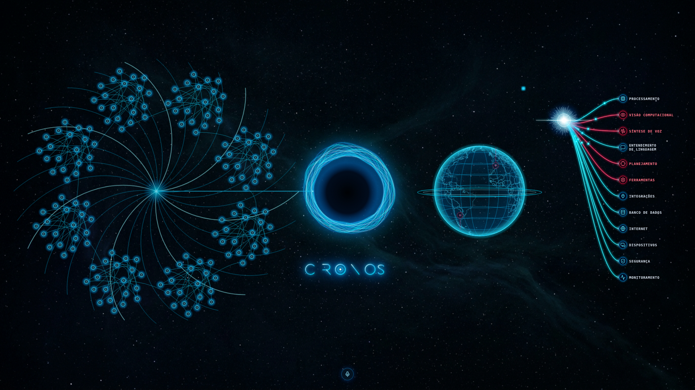

> Atualização: a integração do aplicativo original em tela inteira substitui o visualizador básico descrito abaixo. Consulte [OLHO_DE_DEUS_COMPLETO.md](OLHO_DE_DEUS_COMPLETO.md) para o comportamento atual, F4, serviços e limitações.

# Atualização: configuração original validada

O ZIP original com a configuração real permitiu uma chamada Fish bem-sucedida.
Consulte [Voz original](VOZ_ORIGINAL.md) para importação e evidências atuais.
As hipóteses e falhas de compatibilidade abaixo registram etapas anteriores.

---

# Resultado real do teste legado: HTTP 400

O usuário executou o teste isolado no notebook e recebeu HTTP 400. Isso comprova
rejeição do pedido legado, não identifica sozinho o parâmetro nem comprova falta
de créditos. A tentativa automática de s2.1-pro-free foi removida; o nome constava
no código antigo, mas a disponibilidade atual na API não foi demonstrada.
O exemplo .env voltou a não presumir um modelo.

O teste isolado agora lê no máximo 8 KiB de erro e apresenta apenas os campos
message/msg/detail/error reconhecidos em JSON. Chave, ID de voz, bearer e cadeias
longas são ocultados; não mostra campos input nem salva corpo de resposta.
Isso permite ver se o provedor rejeita modelo, formato ou outro parâmetro sem
publicar credenciais. Os trechos abaixo registram etapas anteriores e não
constituem confirmação de acesso ao modelo legado.

---

# Comparação do ZIP reenviado e teste isolado

O arquivo CRONOS_V32_INTEGRADO_CORRIGIDO.zip reenviado contém 109 arquivos,
mas não contém .env nem config/fish_audio.json. DEFAULT_REFERENCE_ID está vazio.
GUIA_VOZ_JARVIS.md contém sugestões comunitárias, não uma configuração salva;
a sugestão Jarvis é diferente do ID informado pelo usuário. Não foi importada
como se fosse a voz configurada. O reconhecimento antigo era local (Vosk/Whisper).

No modo s2.1-pro-free, o adaptador agora usa JSON com endpoint fixo, TLS,
credenciais locais, timeout de 30 s, resposta limitada a 16 MiB e sem redirects,
reproduzindo o formato de pedido legado. Outros modelos continuam no SDK.
Streaming nesse modo compatível aguarda o áudio completo antes de entregá-lo.
O corpo de erro do provedor não é registrado ou enviado à interface.

`Testar-Voz-Isolada.bat` faz uma única chamada curta ao modo legado e reproduz
WAV pelo Windows, sem iniciar holograma/mapa/IA. Exige a chave e a voz já presentes
no .env local e modo online. Pode consumir créditos conforme a conta. Não migra
credenciais nem altera o .env. Se ele falhar com 402, a interface não estava
aberta nesse teste: há uma recusa da API a esclarecer. Se ele tocar, permite
investigar reprodução/interface separadamente. Não é teste de microfone.
A execução física desse BAT no Windows não foi verificada na nuvem.

---

# Compatibilidade Fish Audio com o Jarvis anterior

A comparação estática do pacote fornecido identificou o modelo padrão
`s2.1-pro-free` e uma tentativa nesse modelo após HTTP 402. O Kronos agora faz
uma única tentativa equivalente na síntese, mantendo texto, voz, formato e
velocidade; não muda para um modelo mais caro. Depois de sucesso, conserva esse
modelo durante a execução. `/status` informa `fish_model_in_use`.
Para selecionar diretamente, use `FISH_MODEL=s2.1-pro-free` no `.env` local,
preservando sua chave e ID de voz. Não foram copiados arquivos de credenciais
nem executado o código legado. O endpoint continua `https://api.fish.audio/v1/tts`.
O SDK usa MessagePack, enquanto o cliente antigo usava JSON; o envio do novo
identificador pelo SDK foi validado com transporte HTTP simulado.

O nome “free” foi encontrado no código antigo, não confirmado por chamada real
hoje. A disponibilidade/cota atual da conta continua dependendo do provedor.
Transcrição é outro endpoint e não troca de modelo TTS. O tratamento de 402 não
significa que o saldo exibido pelo usuário seja zero.

---

# Correção do fluxo de voz

O microfone agora encerra a gravação depois de aproximadamente 1,4 segundo de
silêncio após detectar fala, ou por novo clique. Ruído contínuo pode impedir o
encerramento automático; use o clique nesse caso. Sem fala detectada em oito
segundos, não envia uma transcrição desnecessária. A gravação continua limitada
a 60 segundos. Após transcrever, perguntas vão para a IA e a resposta tenta tocar
pelo Fish, sem exigir clicar Enviar. Texto e memória ficam disponíveis se a voz
falhar. Ações sensíveis continuam exigindo confirmação humana.

O SDK Fish agora usa timeout de 30 segundos por requisição, em vez do padrão de
240 segundos. Isso não promete resposta em 30 segundos nem altera acesso/cota.
A captura mover o núcleo confirma somente sinal do microfone, não transcrição,
resposta da IA ou reprodução. HTTP 402 identifica a etapa recusada pelo provedor;
a causa real ainda exige teste com a conta/API do usuário.

Chromium verificou silêncio automático → transcrição → IA → síntese → evento real
de reprodução, com serviços e entrada de áudio simulados. Windows físico e API
real continuam pendentes. Não foi feita troca de voz/provedor ou de renderizador.

---

# Ajuste posterior à v0.5

A área de memória agora não exibe esqueleto, linhas decorativas ou brilho central.
Com vault vazio não há desenho; novas notas reais e seus wikilinks formam a galáxia
progressivamente. As notas existentes são preservadas e continuam aparecendo.
O núcleo mantém movimento, mas passa de 32 para 20 fios e de 240 para 120 amostras
por fio (aproximadamente 69% menos pontos calculados por quadro, não medida de CPU).
A captura histórica ao fim desta página mostra o esqueleto anterior, agora removido.

Fish Audio não seleciona um modelo por padrão. Após o usuário informar acesso
a S2 Pro no plano gratuito, o bloqueio geral foi removido: `FISH_MODEL=s2-pro`
permite seleção explícita. O nome Pro não determina o plano da conta. Configure `FISH_MODEL` somente depois de verificar
um modelo liberado na sua conta para API. `s1` é aceito pelo SDK, mas isso NÃO
comprova gratuidade. Não há troca automática, assinatura ou compra de créditos.
Sem modelo elegível, respostas automáticas de voz ficam desligadas; conversa e
memória continuam funcionando. Transcrição é um serviço separado e também está
sujeita ao acesso/cota da API Fish. A gratuidade da API não pôde ser verificada:
credenciais reais estão ausentes e a consulta à documentação foi bloqueada pela rede.

Validação do ajuste: 109 testes Python, TypeScript/build e Chromium com vault vazio,
surgimento de notas após conversa, animação do núcleo e mapa passaram. Serviços de
voz/mapa foram simulados. Desempenho no notebook ainda não foi medido.

---

# Memória e Olho de Deus — v0.5

Esta versão remove os controles extras da tela principal: status/desconectado,
configurações, conectar, formulário de token, botão Conversar, rótulo VOZ e botão
volume. Permanecem o palco original e o pequeno microfone da referência. Os símbolos
originais continuam sendo as entradas dos módulos; Linguagem abre conversa.
A chave de proteção interna continua automática, invisível e somente em RAM.
O inicializador usa `pythonw` para não manter um console visível; erros de abertura
são apresentados por mensagem Windows. Sem console não significa sem processos.

## Uso

- A espiral mostra apenas notas reais do vault. Clique em um ponto para ler o
  Markdown; a roda do mouse aproxima/afasta. Os fios decorativos não são notas;
  as conexões entre notas vêm de `[[wikilinks]]` resolvidos, não de relações inventadas.
- Cada troca de conversa salva um novo Markdown em `Memorias`, ligado à conversa
  e às notas de `Temas`. Os temas continuam consolidados; respostas são identificadas
  como produzidas por IA e não verificadas. Não modifica a personalidade do usuário. Alterações manuais no vault são sincronizadas em até um minuto enquanto a janela está visível e ociosa.
- Diga **Kronos, abrir Olho de Deus** ou clique no globo. O mapa ocupa a esquerda
  e a memória vai para o espaço pequeno. O anúncio ocorre após o primeiro quadro
  do mapa, com Fish configurado.
- Com o mapa aberto, diga **abrir cidade de Lisboa**, **abrir aeroporto Charles de
  Gaulle na França**, ou outro lugar no mundo. Não há lista restrita a São Paulo.
  A busca usa Nominatim/OpenStreetMap, pega o primeiro resultado e pode ser ambígua.
  Para homônimos, indique país/estado. Também é possível navegar com mouse/zoom.
- **Abrir Obsidian**, **voltar para memória**, **fechar Olho de Deus** ou Escape
  retornam à espiral. O iframe é removido, destruindo o visualizador, workers e
  seu contexto JavaScript. As notas ficam preservadas.
- **Abrir painel** abre conversa. Comandos reconhecidos de navegação transcritos
  executam a navegação local; outras transcrições seguem para a conversa automaticamente. Fish ausente impede transcrição; texto continua disponível.

## O que está integrado

Foi integrado o **núcleo geográfico** de God's Eye View/Cesium: visualizador 3D,
controle de câmera, imagens mundiais Esri e consulta mundial de lugares. O globo
holográfico pequeno é uma representação decorativa leve, com contornos derivados
de Natural Earth. Ele não mantém um mapa completo escondido. Seus indicadores
vermelhos são decoração, não alertas ou contatos reais.

Ainda **não** estão integradas as camadas de aviões/navios/satélites/câmeras, cidades
fotorealistas 3D, contas e voz próprias do projeto upstream. Não há promessa de
cobertura de câmeras ou detalhes de todo aeroporto. Essas funções requerem trabalho
adicional, fontes, cotas e termos próprios. O mapa atual mostra imagens sobre um
elipsoide, não reconstrução 3D dos prédios ou terreno detalhado.

Fonte MIT: bilawalsidhu/gods-eye-view, commit
`8b8ccc9a81379e8b40d4be67610570ee5b159512`. Atribuição e adaptações estão em
`frontend/src/vendor/gods-eye/PROVENANCE.md`; licenças vêm no pacote.

## Desempenho e segurança

- Canvas do núcleo e estrela agora usam resolução proporcional ao tamanho exibido
  (DPR limitado a 1,25); a geometria original continua nas coordenadas originais.
  Em 1920×1080/DPR1, foram medidos bitmaps 440² e 210², antes 1200² e 600².
  Isso reduz a área total dos dois bitmaps em aproximadamente 87%; não é medida
  de redução de RAM total, CPU ou tempo de quadro.
- Bloom dos fios do núcleo é composto numa camada compartilhada; não há blur
  independente em cada fio dos dois passes. A aparência deve ser conferida no
  notebook; não foi certificado pixel a pixel nem como 85–90% fiel.
- Grafo usa coordenadas calculadas quando os dados mudam, sem simulação física
  a cada frame; desenho limita pontos visíveis a 1200. Paginação da API preserva
  todos os metadados. Vault enorme ainda exige medições/aperfeiçoamento de navegação.
- Cesium só carrega ao abrir o mapa; modo sob demanda, até 30 FPS, tiles em cache
  limitados e escala sem supersampling. A janela principal conserva CSP restrita.
  Apenas `/world/view` permite scripts blob e WebAssembly necessários ao Cesium,
  sem `unsafe-eval` de JavaScript. A origem de imagens é explicitamente limitada.
- Consulta de lugares usa um endpoint HTTPS fixo, timeout, cache limitado e
  espaçamento mínimo de 1,1 segundo; não há busca automática a cada tecla.
  Consulta e imagens enviam região/lugar/IP aos respectivos serviços. Modo local
  bloqueia a busca e a abertura do mapa pela interface. Fontes de mapa têm
  condições e disponibilidade próprias; atribuições permanecem visíveis.
- A interface recebe proteção interna pela ponte desktop e compartilha somente
  com o iframe esperado da mesma origem. Não há credenciais de Gemini/Fish no
  frontend. O mapa não acessa microfone, câmera ou geolocalização.

## Validação e limites

108 testes Python passaram; 2 testes de comandos, TypeScript/build e Chromium com WebGL passaram.
O navegador testou conexão nativa simulada sem formulário, notas reais de teste,
leitura de nota, crescimento após conversa, animação/bitmap, comando de voz,
troca de posições, consulta de aeroporto europeu e remoção do contexto do mapa.
IA/Fish/texturas/geocodificação foram simulados. As tentativas reais de Esri e
Nominatim na nuvem falharam no proxy de rede (CONNECT 403), não em credenciais.
Windows físico, voz Fish real e desempenho no Samsung Flash F30 continuam
pendentes. Não há garantia de ausência de travamentos em 4 GB.

## Atualizar

Feche o Cronos, preserve `.env`, configuração e vault, atualize a branch
`feat/cronos-test-ui`, execute `Instalar-Cronos.bat` e `Iniciar-Cronos.bat`.
A interface e os recursos Cesium já estão compilados: Node não é necessário no
Windows. Node/npm são necessários apenas para editar/recompilar o frontend.

## Tela renderizada durante validação

Captura do programa executando; os pontos desta captura correspondem a 160 notas
sintéticas de teste. Essas notas não acompanham o programa e não são adicionadas
ao vault do usuário. A densidade real depende do seu vault. A imagem não certifica
fidelidade percentual à referência nem desempenho no notebook.
